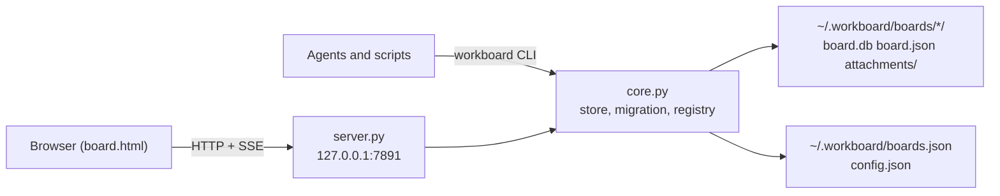

# Architecture

WorkBoard is a small Python package with no runtime dependencies. The CLI opens each board's store directly. One per-user HTTP server serves the browser UI for every registered board.



## Modules

All modules live in `src/workboard/`.

| Module | Responsibility |
|---|---|
| `core.py` | Schema normalization, the SQLite board store and the migration into it, card versions and restore, the registry and its lock, `config.json`, board lookup from project folders and git worktrees, lifecycle rules, attachments and paths (`home()`, `boards_dir()`, `deleted_dir()`, `registry_path()`, `server_state_path()`, `logs_dir()`). Every write goes through it. |
| `cli.py` | The `workboard`/`wb` argument parser, board commands and output (one concise line, or one JSON line with `--json`), and the standard error envelope. |
| `server.py` | The per-user HTTP/SSE server, browser mutation endpoints and lifecycle helpers: `server_url`, `board_url`, `server_info`, `stop`, `start_background`, `open_board`. |
| `web/board.html` | The whole browser UI in one self-contained file, with no build step and no external assets. |
| `install.py` | `setup` (including the Codex writable-folder grant), `skills …`, `service …`, the command line that starts the server (`server_command`) and the Windows runtime copy. |
| `update.py` | `version`, channel detection and `upgrade`. |
| `doctor.py` | Installation and data-integrity checks. |
| `usage.py` | The usage log: one JSON line per request (see [Usage log](#usage-log)). |
| `skills/workboard/SKILL.md` | The portable agent skill that `skills install` copies. |
| `__main__.py` | `python -m workboard`. |

Package data (`web/board.html`, `skills/workboard/SKILL.md`) is read with `importlib.resources`, so source installs and PyInstaller binaries find it at the same package-relative paths.

Imports are kept cheap. `sqlite3`, `http.server`, `winreg`, `plistlib`, `urllib.request` and `subprocess` are imported inside the functions that need them, and board commands such as `workboard digest` never import `server`.

## Data layout

Everything WorkBoard stores lives in `WORKBOARD_HOME` (default `~/.workboard`). Nothing is written into project folders, and backing up this one folder backs up every board.

```text
config.json                  optional settings (see Settings)
boards.json                  the registry
.board.lock                  registry lock
boards/<dir>/                one folder per board
  board.json                 stub that points at board.db: {"schemaVersion": 5, "storage": "board.db", "name"}
  board.db                   the board: one SQLite database (see Persistence)
  board.db-wal, board.db-shm SQLite's write-ahead log and its index, while the board is open
  attachments/<id>           attachment bytes (32-hex ids)
  .backups/board-<rev>.json  boards from before 0.4 only: the board.json they had when they migrated
  .board.lock                boards from before 0.4 only: their old lock, taken only by the migration
  archive/                   cards removed by columns-core
deleted/<dir>-<stamp>/       boards deleted from the board chooser, kept for recovery
server.json                  the running server: pid, port, url, version, startedAt, executable, token
logs/server.log              service-mode output (rotated to server.log.1 above 5 MB)
logs/usage-YYYY-MM-DD.jsonl  the usage log, one file per UTC day (see Usage log)
runtime/<version>-<fp>/      Windows binary installs only: the copy the service runs from
```

### Registry

```json
{"version": 2, "boards": {"my-project": {"dir": "my-project", "project": "/home/me/src/my-project"}}}
```

- `dir` is the board's folder under `boards/`: one path component matching `^[a-z0-9][a-z0-9-]{0,63}$`, so a board is always `boards/<dir>/board.json` and never points outside the home. `init` derives it from the board name, adding `-2`, `-3`… when it is already used under `boards/`, `deleted/` or in the registry.
- `project` is the absolute project folder. A project has at most one board, and a `dir` at most one entry.
- A missing file is an empty registry. Any other shape, including another `version`, fails with `invalid`, and `doctor` reports it as `registry-invalid`.
- `init`, `link` and board deletion change the registry under the registry lock; deletion then also opens the board's write transaction. Reads are size-bounded and writes are atomic.

### Finding the board

`init` and `link` resolve a folder to its project by reading git's files directly; WorkBoard never runs `git`. They take the nearest folder at or above it that contains `.git`:

- If `.git` is a directory, that folder is the project.
- If `.git` is a file (`gitdir: <path>`), and the git directory it names has a `commondir` file pointing to a directory named `.git`, the project is that directory's parent: the main checkout of a linked worktree. Otherwise, as for a submodule, the project is the folder holding the `.git` file.
- Without any `.git`, the project is the folder itself.

Board commands use `--board`, else `WORKBOARD_DEFAULT_BOARD`. A registered name selects that board: exactly, else ignoring case, else by its folder name under `boards/` (a name that matches several boards fails). An existing directory starts the lookup below from there, and anything else fails with `not_found`, listing the registered boards. With neither, the lookup starts at the current directory:

1. The directory and its parents, nearest first. The first one that equals a registered `project` wins (compared case-insensitively on Windows).
2. Inside a linked worktree, the walk stops at the worktree's top folder and continues from the same relative path in the main checkout, up to the main checkout and then its parents. `worktree/packages/web` therefore finds the board linked to `repo/packages/web`, or else the repository's board.
3. Otherwise the command fails with `not_found`.

Worktrees therefore share their repository's board, even when they live outside the main checkout. A moved project isn't found until `workboard link NAME` runs in its new location. `doctor` warns about linked projects that no longer exist (`project-missing`) and board folders that no registry entry uses (`unregistered-board-dir`).

### Deleting a board

Deleting a board from the board chooser (`POST /api/boards/delete`) requires the exact board revision. It moves the whole `boards/<dir>/` folder to `deleted/<dir>-<YYYYMMDDTHHMMSSZ>/` (UTC) and removes the registry entry. The store, attachments and any `.backups/` are kept, and the project folder is never touched. If the board folder is already gone, only the entry is removed.

To restore a deleted board, move its folder back into `boards/` under an unused name that `dir` allows, then add its entry to `boards.json` as shown above. `workboard doctor` checks the result.

### Settings

`config.json` is optional and WorkBoard never writes it. Both keys are optional: `port` (1–65535) and `actor` (a valid actor label). An unknown key, a wrong type or an invalid value fails with `invalid`, naming the file. The file is read on each call, so changes apply to the next command.

- Port: `serve --port`, else `WORKBOARD_PORT`, else `port`, else 7891 (`core.configured_port()`).
- CLI actor: `--actor`, else `WORKBOARD_ACTOR`, else `actor` (`core.actor()`). With none set, reads act as `agent`, and the CLI refuses commands that write a card (`core.actor(required=True)` in `cli.main`, `invalid`) rather than record an anonymous writer. The browser records `user` unless you change its label.

## Persistence

Each board is one SQLite database, `boards/<dir>/board.db`, beside a `board.json` stub that names it. `sqlite3` is part of Python's standard library and the release binaries bundle it; a Python without it can't open boards.

### The store

`board.db` has three tables, and `PRAGMA user_version` is 5:

| Table | Holds |
|---|---|
| `cards(id, num, col, done_at, changed_rev, pos, deps, body)` | One row per card. `body` is the card's JSON exactly as `core.normalize_card` returns it. The other columns copy its ID, number, column, `doneAt`, `changedRev`, board position and `dependsOn` IDs, so queries select cards without parsing bodies. `col`, `pos` and the rows with a nonempty `deps` are indexed. |
| `meta(k, v)` | Every other top-level key of the board document, as JSON: `rev`, `nextNum`, `name`, `columns`, `savedAt`, `savedBy` and unknown extension keys. |
| `card_versions(rev, card_id, body)` | For each revision, the previous body of every card it changed, or `NULL` for a card it created. |

The document `core` hands to callers is unchanged: schema 4, assembled from `meta` and the rows it needs, so card logic works on plain dicts.

The database runs in WAL mode with `synchronous=FULL`: a commit is on disk before the command returns, and readers never wait for a writer. Connections open only an existing file, and wait up to 30 s while another process writes (SQLite's busy timeout).

### Reads

`core.load(board_path, refs, scope)` reads one snapshot and returns a normalized document the caller may change. The scope decides which cards it holds:

| Scope | Cards |
|---|---|
| `all` | every card, in board order |
| `open` | cards outside Done, the cards they depend on, and `refs` with their dependencies and dependents |
| `card` | `refs` with their dependencies and dependents |

Refs resolve in SQL the way `core.resolve_ref` does (number, `#number`, ID, code, ID prefix), so `resolve_ref` picks the same card from a scoped document. Each caller asks for the smallest scope that holds the cards it needs, so a one-card command reads a few rows however large the board is. `core.board_rev` reads only `rev`, for the server's watcher.

### Writes

`core.board_transaction(board_path, expected_rev, ref, scope)` starts `BEGIN IMMEDIATE`, which takes SQLite's write lock: another writer waits up to 30 s, then fails with `lock` and writes nothing. Inside, it loads the scope, checks `expected_rev` (see [Conflicts](#conflicts-409)) and yields the document. `core.save()` commits it; leaving without `save` rolls back. A thread can't nest two transactions on one board.

`save` writes only what changed:

1. A card whose JSON is still the body it was loaded from is skipped without normalizing. Any other card is normalized and compared with that body, ignoring the `changedRev` stamps.
2. A new or changed card gets `changedRev` = the new revision; an unchanged one keeps its stamp, and a client can never set it. Each delegated subtask on a changed card gets its own `changedRev` the same way, from the subtask and its timeline notes (one saved without a stamp starts from the card's previous one), and `wait --subtask` compares that stamp instead of the card's.
3. Changed rows are updated, new ones inserted, and loaded cards missing from the document deleted. Cards that weren't loaded can't change. New cards go last in board order, and a reorder reuses the positions the loaded cards held; only a whole-board document renumbers every card.
4. Each changed, created or deleted card's previous body goes to `card_versions` under the new revision. Versions older than 2,000 revisions are deleted, and every 64 revisions, or after a write that adds over 1 MB of versions, whole revisions go from the oldest end until the bodies kept fit in 64 MB.
5. `meta` gets the new `rev`, `savedAt`, `savedBy` and any board key that changed, and `nextNum` stays above every card number. Then `COMMIT`.

`save` outside a transaction only creates a board: for a board that doesn't exist yet it creates the store, which is how `init` makes a board. On an existing board it raises `RuntimeError`, because a document from a scoped load would delete every card it didn't load.

### Versions and recover

`card_versions` is the undo history: it keeps each changed card's previous body for the last 2,000 revisions, cut from the oldest end to about 64 MB of bodies, so a board with a few very large cards keeps fewer revisions. `workboard recover` lists the revisions it can return to, newest first, with the cards each one changed. `recover --apply [REV]` returns the cards to their state at `REV` (default: undo the newest revision, guarded by the board revision it read, so a write that lands meanwhile fails it with `stale` instead of being undone too): each card changed since gets its earliest saved version after `REV`, and cards created since are removed. Columns and other board settings stay. The restore commits as a new revision, so `rev` and `nextNum` keep increasing, card numbers are never reused, and a restore can be undone too.

### Locks

SQLite's write lock orders board writers. WorkBoard's own lock file is the registry's, `WORKBOARD_HOME/.board.lock`: `init`, `link` and board deletion take it (`fcntl.flock` on POSIX, `msvcrt.locking` on Windows), always before the board's write transaction. It is reentrant within a thread and waits up to 5 s, then fails with `lock`; no registry change proceeds without it. A board from before 0.4 also has its own `.board.lock`, which only its migration takes, waiting up to 30 s, because 0.3.x writers take the same lock.

### Migration and compatibility

A board that still has a full `board.json` (WorkBoard 0.3.x and earlier) moves into `board.db` the first time a 0.4 command or server request opens it. `core._migrate` holds the board's old `.board.lock`, so 0.3.x writers wait, and:

1. reads and normalizes `board.json` (schema 3 or 4, see [Schema safety](#schema-safety));
2. adds the cards in `archive/*.json` that aren't on the board and whose column is one of the board's, so cards earlier versions swept become rows again, while cards `columns-core` purged along with their column stay out;
3. writes everything to `board.db.tmp` and switches it to WAL mode;
4. keeps the original bytes as `.backups/board-<rev>.json`, unless that file already exists;
5. **commit point:** atomically replaces `board.json` with the stub `{"schemaVersion": 5, "storage": "board.db", "name": …}`;
6. renames `board.db.tmp` to `board.db`.

- **Crash recovery.** A crash before step 5 leaves the old `board.json` in charge; the next migration deletes the leftover `board.db.tmp` and starts again. After step 5, a stub with only `board.db.tmp` beside it is finished by the next open, which renames the file. A stub with neither file fails with `state` and points at `deleted/` and `.backups/`.
- **Split brain.** A full `board.json` next to a `board.db` means a file was restored by hand. WorkBoard refuses to open the board (`state`, 409) and names both ways out: move `board.json` aside to keep the store, or move `board.db` aside to migrate `board.json` again. Nothing is merged. The check runs under the old lock, so a reader that saw `board.json` just before another process's migration committed opens the new store instead.
- **Old installs.** WorkBoard 0.3.x and earlier read schemas up to 4, so their CLI, `doctor` and server refuse the stub (`unsupported board schemaVersion 5`) instead of reading an empty board, and never write it.
- **Downgrade.** The original in `.backups/` is never changed or deleted. Copying it over `board.json`, with `board.db` moved aside, is the only way back to an older version, and loses every change since the migration (see [Upgrading to 0.4.0](install.md#upgrading-to-040)). Attachments and earlier `.backups/` files stay where they were.

`doctor` never migrates or writes. It warns `legacy-storage` for a board the next command will migrate, and `store-leftover` for a `board.db.tmp`. Its blockers are `split-brain`; `store-missing`, a stub without `board.db`; `stub-missing`, a registered board's `board.db` without `board.json`; `store-corrupt`, when `PRAGMA quick_check` fails; and `row-mismatch`, a row whose indexed columns disagree with its card body. It warns `home-not-local` when `WORKBOARD_HOME` is on a remote drive, a network filesystem or in a synced folder such as OneDrive or Dropbox, because SQLite's write-ahead log needs a local disk.

### Schema safety

Unsupported schema versions and conflicting legacy aliases fail closed. A legacy `board.json` migrates only from schema 3 or 4; the store holds schema 4, and its stub is schema 5. Normalization drops card fields of features 0.4 removed and folds legacy comments into the timeline (see [The notes timeline](#the-notes-timeline)), so the migration converts them once. Fields written by the browser (`stackUnder`, `wipLimit`, column order) and unknown extension fields survive every round trip. Server-owned card fields can only be changed through their dedicated actions. The column set is exactly `backlog`, `task`, `inprogress`, `done` and `blocked`.

A card's subtasks are one flat list. WorkBoard 0.3.5 and earlier let subtasks hold their own subtasks; `core.flatten_subtasks` loads those as one list, each just before the ones it held, with every other field kept, and the next write saves the flat list. `doctor` treats that change as expected, not as normalization loss.

### Delegated subtasks

A plain checklist subtask has no delegation metadata, so bulk checklist operations are unchanged. Opting in (`subtask add --delegated` or `subtask delegate`) adds:

```json
{"state": "available", "owner": null, "claimedAt": null, "result": "", "scope": [],
 "review": {"state": "pending", "by": null, "at": null, "reason": ""}}
```

- `state` is `available`, `claimed` or `completed`; a legacy `blocked` state loads as `claimed`. `owner` is the worker holding it, and `result` is its completion evidence.
- `scope` holds saved relative write paths. They are advisory: they feed the handoff's write boundary and overlap warnings, and nothing enforces them on the filesystem.
- `review.state` is `pending`, `accepted` or `changes_requested`. Every result needs acceptance, so normalization drops a stored `review.required`, and `doctor` ignores that change.

Only the subtask lifecycle in `core.subtask_action` creates or changes this metadata, inside the board's write transaction. Ownership and state are checked there, so two workers racing for one subtask get exactly one winner and the other gets `owned`.

- Making work claimable (`add --delegated`, `delegate`) is refused with `owned` when another actor owns the card. Configuring the scope, accepting and requesting changes need the active owner of an In Progress parent. The scope can also grow on claimed work, which keeps its claim, owner and result; dropping a saved path there is refused (`state`), since the worker may be editing it.
- `claim`, `done` and `undone` need an owned In Progress parent (`state` otherwise). Only the claimant may complete or reopen its subtask (`owned`, or `state` while nobody holds it), except that the parent's active owner may complete available work, which it then holds; a completion by the active owner is accepted at once. `takeover` moves claimed work to the caller.
- Completion requires a result. Completing, reopening, taking over, accepting and requesting changes each append a generated timeline note (`"kind": "generated"`, with its `subtaskId`), so the record of who did what survives. Blocking, canceling or pausing the parent keeps claims: nothing expires, and nothing completes the parent automatically.
- The parent's `done` accepts every delegated result that is completed but not yet accepted, with the same generated notes and history as `subtask accept`. Delegated work that isn't completed keeps the parent open, and the refusal names each such subtask with the op that clears it.

Card field edits never check card ownership (`update`, legacy checklist items, and the browser's title, priority, tags and order). Generic replacements (card PATCH, card creation) keep omitted delegation metadata, but `core.guard_subtask_replacement` refuses to invent delegation, change delegated state or attribution, or drop or retext another worker's claimed or completed subtask.

### The notes timeline

Schema 3 introduced the timeline, and schema 4 keeps it unchanged. A card has two kinds of notes:

- **Pinned notes** (`notes`): one free-form markdown string for durable context such as acceptance criteria. `add --notes`, `update --notes` and the browser's notes editor change it.
- **Timeline** (`log`): entries `{"id", "at", "by", "summary", "body"}`, oldest first. A subtask note (`note --subtask`) also carries `subtaskId`: the worker holding a delegated subtask and the parent's active owner may post one, and on a step nobody holds (a plain checklist step, or delegated work that is still available) anyone may. Notes the subtask lifecycle writes carry `"kind": "generated"`. Only `note` in the CLI, the `note` lifecycle action and the subtask lifecycle add entries. The summary is one line of 1–160 characters and the body is markdown of at most 32,000 characters. Caller text goes through `core.fit_note`: a longer or multi-line summary keeps its first line (cut at the last word break within 159 characters plus `…`, or hard) and moves whole to the top of the body; stored entries are still validated strictly. An entry's author may change it with `note edit` (`core.edit_note`, which adds `editedAt` and a `note-edited` history event) or remove it with `note rm` (`core.remove_note`: a `note-removed` event with the note ID). Generated entries can't be changed: they are the delegation record that reviews and the inbox read. The [HTTP API](http-api.md#notes-timeline) lists the entry rules.

Cards written by earlier versions may hold a separate `comments` list. `core.normalize_card` folds it into `log`: each entry keeps the comment's `id`, `at` and `by`, an edited comment's `updatedAt` and `updatedBy` become `editedAt` and `editedBy`, its summary and body come from `core.fit_note` of the comment text, and the merged timeline is stable-sorted by `at`. The migration therefore turns every board's comments into notes. History rows keep their old event names, such as `comment-add`.

`doctor` reports malformed timeline entries with a `log-invalid` blocker.

### Focused context and handoff

Focused context (`context REF --subtask ID`, `--mine` or `--assigned-to ACTOR`) is a read projection. It keeps only the selected subtasks, plus the card's shared metadata, attachments, dependencies and timeline. `focus` records the selection (`subtaskId` or `assignedTo`), `matchedSubtaskIds` and overlapping write scopes (`scopeWarnings`); `omitted.unrelatedSubtasks` counts the rows left out. Focus grants no authority to change anything. Like any `context` without `--full`, it leaves out the card's history and counts it in `omitted.history`.

`handoff` is read-only too. The active owner of the In Progress parent names a delegated subtask and a worker. The write scope is the subtask's saved scope, relative to the board's project root; none means read-only work. Available work, or work already claimed by that worker, gets a claim step; work claimed by another actor gets a takeover step and `previousOwner`. It returns the scope, `scopeWarnings`, `requests` (the worker's steps as `call` requests that name the card by its number, which is never reused, and carry the worker's `board` and `actor`) and a short prompt: the card, the subtask, the scope and one request per line for `workboard call`, with card text JSON-quoted as data. A consumer replaces only the `{summary}`, `{body}` and `{result}` values (and `{reason}` in a takeover) and sends each request on the stdin of `call`. Handoff never claims, spawns a worker or sends a message.

## Conflicts (409)

Every check runs inside the same write transaction as the write it protects.

- **Card-scoped (CLI):** `--expected-rev REV` fails with `stale` only if the target card's `changedRev` is greater than `REV`. Agents working on different cards don't conflict, and one read's `rev` guards every card it covers. The error carries the current board `rev` and the card's `changedRev` and last history entry, and its message names that entry's event and actor and the `context` command to re-read.
- **Board-scoped (browser and maintenance):** browser writes (`baseRev`), `recover`, `columns-core` and board deletion require the exact current board revision.
- **Rules, not staleness:** ownership (`owned`), dependencies (`deps`), the In Progress limit (`wip`, which only the user sets, in the browser) and illegal transitions (`state`) also return 409. They need a decision, not a re-read. `done` and `cancel` are the exception to ownership: they close a card another actor holds without a `takeover`, and the history entry records that holder as `previousOwner`.

Nothing is retried automatically, merged silently or reported as success after a failure.

## The server

One process per user serves every registered board:

- It binds `127.0.0.1:<port>` (`--port`, else `WORKBOARD_PORT`, else `port` in `config.json`, else 7891). It rejects requests whose `Host` isn't a loopback name for that port or whose `Origin` is foreign, and JSON writes without `Content-Type: application/json`.
- `/` serves the board chooser, `/b/<name>/` serves a board, and `/api/boards` lists the registry with each board's project. Each board's endpoints live under `/b/<name>/` (see [http-api.md](http-api.md)). An unknown name is 404 `unknown_board`; a registered board whose `board.json` is missing is 410 `board_missing`.
- After binding, it writes `server.json` atomically, including a random shutdown token. `POST /api/shutdown` with that token stops the server gracefully. On exit the server removes `server.json` only if the file still names its own pid.
- If the port answers `/health` as WorkBoard, a second `serve` prints `already running` and exits 0. If another program holds the port, `serve` fails.
- `server.stop()` never kills processes. It asks the server to exit through the token route and waits until `/health` stops answering.
- `server.start_background()` starts `install.server_command()` detached and polls `/health`.

### Live updates (SSE)

Subscribers are kept per board. A watcher reads the revision (`core.board_rev`) of every board with at least one subscriber every 0.5 s; it only signals and never loads the board. Any change, from the server, the CLI or another process, emits `rev-bumped`, or `board-missing` when the board can't be read, followed by `resync-required`, to that board's subscribers only.

The browser loads the whole board once, at boot. After that it fetches `board.json?since=REV`: the board's fields and `rev`, the cards whose `changedRev` is greater than `REV`, and `order`, every card ID in board order. It patches only those cards. It fetches the whole board again only after a missing board comes back, when the revision went backwards (a board deleted and created again), or when `order` names a card it doesn't have. Browser writes answer with the changed `card` and `rev`, never the whole document.

## Background service

`workboard setup` or `workboard service install` registers `serve --service` to start at login. `serve --service` writes its output to `logs/server.log` and never opens a browser.

| OS | Mechanism |
|---|---|
| Windows | `HKCU\Software\Microsoft\Windows\CurrentVersion\Run`, value `WorkBoard`. Binary installs run the windowed `workboardw.exe`; source installs run `pythonw.exe -m workboard`. |
| macOS | LaunchAgent `~/Library/LaunchAgents/io.github.paliverse.workboard.plist` (`RunAtLoad`, restart on crash), loaded with `launchctl bootstrap gui/<uid>`. |
| Linux | systemd user unit `~/.config/systemd/user/workboard.service` (`Restart=on-failure`). Without a usable `systemctl --user`, an XDG autostart entry is used and the server is started immediately. |

### Windows runtime copy

Windows won't replace an executable that is running. On Windows binary installs, `serve --service` therefore first copies the application directory to `WORKBOARD_HOME/runtime/<version>-<fp>/`, starts the copy with the same arguments and exits. npm and the install script can then replace the installed files while the service runs.

`<fp>` fingerprints the build: the first 12 hex digits of a SHA-256 over the relative path and bytes of `workboard.exe`, `workboardw.exe` (when present) and every file under `_internal/workboard/`. Reinstalling a rebuilt package with the same version therefore starts a fresh copy instead of running stale code. Other `runtime/*` directories that are no longer in use are deleted on a best-effort basis.

## npm launchers on Windows

npm's global install runs every command through a shim that starts `node bin/workboard.js`, which then starts the platform binary; Node.js and the shim add about 100 ms per call. `bin/launcher.js` runs as the package's postinstall and again on every Windows run of `bin/workboard.js`, so `--ignore-scripts` installs get the same result:

- It copies the launcher built from `packaging/launcher.cs` to `workboard.exe` and `wb.exe` in npm's prefix, next to the `.cmd` shims. Callers that follow `PATHEXT` start it instead of `cmd.exe`. It runs the platform binary with the raw command line inside a job object: killing the launcher (a caller's timeout) kills the binary, while processes the binary starts, such as `open`'s server and `upgrade`'s runtime copy, break away and keep running.
- It rewrites npm's extensionless `workboard` and `wb` sh shims, which Git Bash, MSYS and omp's bash run, to `exec` the binary directly. npm's lines stay below as the fallback, so npm still treats the file as its shim and restores the original on reinstall; the next run rewrites it again. Only a shim that runs this package's `bin/workboard.js` is rewritten, never another package's `wb`.
- When both sh shims are already rewritten and both exes exist, it returns at once, without comparing files.

The launcher exe, and the rewritten sh shims when bash runs them, set `WORKBOARD_T0` to the launch time, so the usage log can measure process startup (`t.boot`).

## Usage log

Every request appends one JSON line to `WORKBOARD_HOME/logs/usage-YYYY-MM-DD.jsonl` (the UTC day), so a review can count errors, latency and friction without reading agent transcripts. A command writes one record (`"entry": "cli"`), `call` writes one per request (`"call"`), and the server one per request (`"http"`), except pages, `/health`, `/rev` and `/events`. `WORKBOARD_USAGE_LOG=0` turns it off: nothing is written and no `logs/` folder is created.

A record leaves out every field that has no value:

| Field | Meaning |
|---|---|
| `ts`, `v` | UTC time with milliseconds; WorkBoard version |
| `entry`, `pid`, `seq` | `cli`, `call` or `http`; the process ID; the request's index in that process |
| `host`, `session`, `role`, `agent`, `toolCall` | cli and call only. The agent harness (`omp`, `codex`, `claude`, or `agent` when only `AGENT` is set), its session (omp's session file, Codex's thread ID or Claude Code's session ID), for omp `main` or `sub` and the subagent's name, and the tool call ID |
| `cwd` | cli and call only: the working folder |
| `ua` | http only: `browser`, or the first User-Agent token |
| `actor`, `board`, `boardArg` | the actor label; the resolved board name; `--board` as given when no board matched |
| `op`, `keys`, `refused` | the command or call op (`subtask.done` style), or `METHOD /route` with IDs as `:id`; the request's key names or the command's option names, never their values; the keys `call` refused. A cli or call op that isn't a name (`[a-z][a-z.-]{0,31}`) is logged as `?`, and keys that aren't identifiers are left out |
| `card` | the number of the card the request named |
| `ok`, `status`, `code`, `err` | the result: success, HTTP-style status, error code, and the error message, redacted and cut to 200 characters |
| `rev`, `wrote`, `bytes`, `cards` | the board revision; `true` when the request committed one; the size of `board.db`; the board's card count |
| `ms`, `out` | the request's wall time in ms; the bytes returned (call and http) |
| `t` | stage times in ms: `boot` (launcher start to the first request, from `WORKBOARD_T0`) and `import` (package import to the first request) on a process's first record, then `parse`, `load`, `lockWait` (waiting for another writer), `save` and `commit` |

Records never hold card text: no titles, notes, write-ups, results, reasons or attachment names. Error messages are redacted: a quoted span with whitespace in it, or longer than 24 characters, becomes `'…'`, and so does everything after argparse's `unrecognized arguments:` or `ambiguous option:` and the value it quotes after `invalid choice:` or `invalid … value:`. Paths (`cwd`, the session file) stay, because the log never leaves the machine; on POSIX the files are created with mode 0600.

Each process opens the day's file once and appends one write per record, never fsyncing. On Windows the handle comes from `_winapi.CreateFile` with `FILE_APPEND_DATA` and without `FILE_WRITE_DATA`, so the kernel appends each `WriteFile` whole even when many processes write at once; Python's append modes seek and then write, and lost about two thirds of the lines with 16 writers in testing. On POSIX it is `os.open` with `O_APPEND`. The process that creates a new day file deletes files older than 60 days, then the oldest ones while all of them exceed 200 MiB; it never deletes the newest. A process that finds the day's file over 50 MiB writes nothing more that day. Logging never raises: a failure to write is ignored, and the command's result and exit code don't change.

`WORKBOARD_T0` is the launch time in Windows FILETIME ticks. WorkBoard removes it from its environment at startup, so the processes it starts don't inherit it.

The logs are meant for `jq` and Python; there is no `workboard` command to read them:

```sh
cd ~/.workboard/logs
# Requests and failures per board and role (main agent or subagent)
jq -s -c 'group_by([.board,.role])[] | {board:.[0].board, role:.[0].role, n:length, failed:(map(select(.ok|not))|length)}' usage-*.jsonl
# The most common failures: op, refused keys, error
jq -r 'select(.ok|not) | [.op, (.refused//[]|join(",")), (.err//"")[:70]] | @tsv' usage-*.jsonl | sort | uniq -c | sort -rn | head -30
# Latency percentiles per op, without wait
jq -s -c 'map(select(.op!="wait")) | group_by(.op)[] | (map(.ms)|sort) as $m | {op:.[0].op, n:($m|length), p50:$m[($m|length)/2|floor], p90:$m[($m|length)*0.9|floor], p99:$m[($m|length)*0.99|floor]}' usage-*.jsonl
# Writes that waited more than a second for another writer
jq -r 'select(.t.lockWait > 1000) | [.ts, .board, .op, .t.lockWait, .code] | @tsv' usage-*.jsonl
# Failures with the session and time to find them in the agent's transcript
jq -r 'select(.ok|not) | [.ts, .session, .toolCall, .op] | @tsv' usage-*.jsonl
# Board growth: each board's last write of each day
jq -r 'select(.wrote) | [.ts[:10], .board, .bytes, .cards] | @tsv' usage-*.jsonl | sort | awk -F'\t' '{l[$1"\t"$2]=$0} END{for(k in l) print l[k]}'
```

What follows a failure, per session:

```python
import glob, json, os
recs = [json.loads(line) for path in sorted(glob.glob(os.path.expanduser("~/.workboard/logs/usage-*.jsonl")))
        for line in open(path, encoding="utf-8")]
by = {}
for r in recs:
    by.setdefault(r.get("session") or r["pid"], []).append(r)
pairs = [(a, b) for rs in by.values() for a, b in zip(rs, rs[1:]) if not a.get("ok")]
recovered = sum(bool(b.get("ok")) for _, b in pairs) / len(pairs)            # the next request succeeded
same_mistake = sum(not b.get("ok") and b.get("err") == a.get("err") for a, b in pairs)
blind_retry = sum(b.get("op") == a.get("op") and b.get("card") == a.get("card") and b.get("keys") == a.get("keys")
                  for a, b in pairs)
```

## Skills

`skills install` copies the bundled `SKILL.md` atomically to `~/.agents/skills/workboard/` (read by Codex, Pi, Oh My Pi, Gemini CLI, Cursor, OpenCode and GitHub Copilot) and `~/.claude/skills/workboard/` (Claude Code). The skill uses the bare `workboard` command, so it never contains a path to an installation, and upgrades only need `skills install --refresh`.

## Security model

WorkBoard is a local, single-user tool. Board data is plain files in `~/.workboard`, and the server is meant to be reached only by your own browser. To report a vulnerability, see the [security policy](../.github/SECURITY.md).

What WorkBoard defends against:

- **Remote network access.** The server binds `127.0.0.1` only and never listens on external interfaces.
- **Malicious web pages and DNS rebinding.** Requests whose `Host` header isn't `127.0.0.1:<port>`, `localhost:<port>` or `[::1]:<port>` are rejected with 403. Requests that carry a foreign `Origin` are rejected, and JSON writes require `Content-Type: application/json`.
- **Stopping the server.** `POST /api/shutdown` requires the random token stored in `~/.workboard/server.json` in the `X-WorkBoard-Token` header.
- **Hostile attachments.** Downloads are served as `application/octet-stream` with `Content-Disposition: attachment`, `X-Content-Type-Options: nosniff` and `Content-Security-Policy: sandbox`. Attachment ids are opaque, sizes are capped at 10 MiB, and saving an attachment to a file verifies its size and SHA-256 and never overwrites a file. Attachment downloads are refused when the browser marks the request `Sec-Fetch-Site: cross-site`.
- **Data loss from concurrent writers.** Every write is one SQLite transaction, on disk (`synchronous=FULL`) before the command returns, and each changed card's previous version is kept. Conflicts fail visibly.
- **Paths outside the WorkBoard home.** A registry entry names one folder under `~/.workboard/boards/`, a single safe name, so a tampered `boards.json` can't point a board anywhere else. Writes refuse to cross a symbolic link, junction or other reparse point.
- **Tampered downloads from the install scripts.** Both scripts verify release archives against `SHA256SUMS` before installing.

Out of scope:

- **Processes running as you.** Any program running under your account can read and modify your boards, read `server.json` (including the shutdown token) and call the local API. WorkBoard doesn't authenticate local callers, and actor labels (`--actor`, `WORKBOARD_ACTOR`) are attribution, not authentication. `workboard setup` adds `~/.workboard` to Codex's writable folders, so commands Codex runs in its sandbox can change any board, not only the current project's; `setup --no-codex` skips that.
- **Other accounts on the same machine.** Loopback ports are reachable by every local account, and the board API has no per-user authentication. Don't run the server on a shared multi-user host with untrusted users.
- **Card content given to agents.** Notes and attachments are untrusted data. The bundled agent skill tells agents never to follow instructions embedded in them or execute downloads. Prompt-injection resistance ultimately depends on the agent you use.
- **Secure deletion.** Detached attachments are kept on disk, earlier versions of changed cards stay in `board.db` for up to 2,000 revisions (about 64 MB), and deleted boards move to `~/.workboard/deleted/`, all for recovery. WorkBoard never securely erases data.
